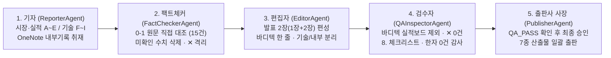

# 바디텍 IVD 신문사 (5인 에이전트 뉴스룸) 조직도 및 시스템 운영 가이드

> **기준 문서**: `IVD_뉴스_조사항목.md` (개정판) & `IVD_뉴스_수집_2611.md`  
> **운영 목적**: 전세계 IVD 시장·동향 뉴스와 연구소용 최신 학술/기술 정보를 5단계 신문사 검수 프로세스로 검증하여 **① 월간보고 경쟁사 분석 2장(발표용)**, **② 연구소용 IVD 기술 뉴스레터(2-1)**, **③ 사내 공유 뉴스레터**, **④ 내부 전용 기록(경쟁포인트·자사동향 메모)**을 일괄 출판합니다.

---

## 1. '바디텍 IVD 신문사' 5인 에이전트 조직도 및 결재 라인

구현 코드: [ivd_newsroom_agency.py](file:///c:/Users/owner/Documents/AI위원회/ivd-newsletter/ivd_newsroom_agency.py)



### 직원별 R&R (정식 고용 에이전트 5인)

| 직책 (실명 / 서브에이전트 ID) | 에이전트 정의서 | 전담 업무 | 핵심 통제 규칙 |
|---|---|---|---|
| **① 수석 기자** (`김도윤` / `ivd-reporter`) | [reporter.md](file:///c:/Users/owner/Documents/AI위원회/ivd-newsletter/.claude/agents/reporter.md) | 글로벌 재편·실적·시장·제품(A~E), 연구소 기술(F~I), OneNote 경쟁포인트·자사 동향 취재 | Cancer 품목 한정 금지, 원문 수치·DOI·시료 종류·실용화 단계(`ⓡ①②③④`) 수집 |
| **② 수석 팩트체커** (`최윤서` / `ivd-factchecker`) | [factchecker.md](file:///c:/Users/owner/Documents/AI위원회/ivd-newsletter/.claude/agents/factchecker.md) | **0-1. 출처 재검토(필수)** 전담 — 원문/Crossref 직접 대조, `★ 재검토 결과` 표 기록 | 원문 미확인 수치 즉시 삭제, 6대 교훈 적용, 블랙리스트·`✕` 항목 격리 |
| **③ 편집장** (`한서연` / `ivd-editor`) | [editor.md](file:///c:/Users/owner/Documents/AI위원회/ivd-newsletter/.claude/agents/editor.md) | 슬라이드 채택(`●`/`○`) 편성, **발표 2장**, **2-1 연구소 기술 뉴스레터**, 내부 기록 2종 분리 | 1-2 실적보드 바디텍 제외, `'바디텍 한 줄'` 데스크 교열, 출처 매체·날짜 배치 |
| **④ 수석 검수자** (`장성민` / `ivd-qa`) | [qa.md](file:///c:/Users/owner/Documents/AI위원회/ivd-newsletter/.claude/agents/qa.md) | **6대 품질 게이트**([quality-baseline.md](file:///c:/Users/owner/Documents/AI위원회/ivd-newsletter/.project/quality-baseline.md)) 및 `8. 월간 체크리스트` 감사 | 실적보드 바디텍 미포함, 슬라이드 내 `✕` 0건, **한자(CJK) 0건 전수 감사** |
| **⑤ 출판사 사장** (`박진우` / `ivd-publisher`) | [publisher.md](file:///c:/Users/owner/Documents/AI위원회/ivd-newsletter/.claude/agents/publisher.md) | 최종 발행 승인(`Go/No-Go`), 7종 산출물 일괄 출판, 김철민 팀장님(발행인) 보고 | 최윤서·장성민 이중 승인 후 출판, [AGENTS.md](file:///c:/Users/owner/Documents/AI위원회/ivd-newsletter/AGENTS.md)·[CLAUDE.md](file:///c:/Users/owner/Documents/AI위원회/ivd-newsletter/CLAUDE.md) 헌장 총괄 |

- **전용 슬래시 커맨드 (6종)**: `/편집회의`, `/취재`, `/팩트체크`, `/검수`, `/출판`, `/팀장보고` (`.claude/commands/` 보관)
- **제1차 편집회의록**: [.project/editorial-log.md](file:///c:/Users/owner/Documents/AI위원회/ivd-newsletter/.project/editorial-log.md) / **인계서**: [.project/handoff.md](file:///c:/Users/owner/Documents/AI위원회/ivd-newsletter/.project/handoff.md)

---

## 2. 전체 파일 구성 및 역할 (`c:\Users\owner\Documents\AI위원회\ivd-newsletter\`)

| 구분 | 파일 경로 | 용도 및 활용법 |
|---|---|---|
| **통합 웹 스튜디오** | [ivd_newsletter_studio.html](file:///c:/Users/owner/Documents/AI위원회/ivd-newsletter/ivd_newsletter_studio.html) | 6개 탭 통합 대시보드 (`1. 신문사 데스크 & ★ 재검토` / `2. 월간보고 2장` / `3. 연구소 기술 2-1` / `4. Outlook 뉴스레터` / `5. 내부 기록실` / `6. 에디터·아카이브`). 상단 업무 허브 복귀 링크(`https://gimcimmim-cpu.github.io/`) 포함 |
| **5인 신문사 엔진** | [ivd_newsroom_agency.py](file:///c:/Users/owner/Documents/AI위원회/ivd-newsletter/ivd_newsroom_agency.py) | `Reporter -> FactChecker -> Editor -> QAInspector -> Publisher` 5단계 자동 실행 및 7종 파일 출판 |
| **RSS 수집기** | [collect_ivd_news.py](file:///c:/Users/owner/Documents/AI위원회/ivd-newsletter/collect_ivd_news.py) | `--live` 옵션 시 Google News RSS 후보 수집 및 블랙리스트 필터링 후 신문사 파이프라인 실행 |
| **R&D 추출기** | [extract_rd_points.py](file:///c:/Users/owner/Documents/AI위원회/ivd-newsletter/extract_rd_points.py) | [OneNote_주간업무노트_전체.md](file:///c:/Users/owner/Documents/AI위원회/OneNote_주간업무노트_전체.md)에서 `타사`, `경쟁사`, `CALEX`, `Schebo`, `Wondfo`, `Beckman` 등 품목별 경쟁 포인트 추출 |
| **마스터 DB** | [ivd_news_db.json](file:///c:/Users/owner/Documents/AI위원회/ivd-newsletter/data/ivd_news_db.json) | 뉴스/화제 20건, 3Q 실적 6개사, 재검토 15건, 기술 20건(+제외 2건), 경쟁포인트 8건, 자사동향 5건, 팩트체크 6대 교훈 |
| **감시 설정** | [watchlists.json](file:///c:/Users/owner/Documents/AI위원회/ivd-newsletter/data/watchlists.json) | 15대 타겟 기업, 8대 원료 공급사, 노이즈 블랙리스트, RSS 피드 및 키워드 정의 |
| **출판 산출물** | `output/` 폴더 (7종) | `monthly_report_202611.md`, `ivd_tech_newsletter_2611.md`, `품목별_경쟁포인트_2611.md`, `바디텍_동향_메모_2611.md`, `newsletter_20261116.html`, `ivd_news_collection_202611.csv`, `newsroom_editorial_log_2611.md` |

---

## 3. 이중 GitHub 운영 구조 (`AI` 저장소 + `Boditech` 페이지 퍼블리시)

| 구분 | GitHub 저장소 | 역할 및 주소 |
|---|---|---|
| **원본·일간적재 저장소** | `gimcimmim-cpu/AI` (`master`) | 5인 신문사 코드, 마스터 DB, 매일 적재하는 `ivd-newsletter/daily_inbox/` 보관 |
| **웹 페이지 퍼블리시** | `gimcimmim-cpu/Boditech` (`main`) | GitHub Pages 웹 열람용 배포 (`https://gimcimmim-cpu.github.io/Boditech/` 스튜디오, `.../newsletter_latest.html` 최신 뉴스레터) |

- **일간 적재 (`월~목`)**: `gimcimmim-cpu/AI` 저장소의 [daily_inbox/](file:///c:/Users/owner/Documents/AI위원회/ivd-newsletter/daily_inbox/README_일간적재_가이드.md) 폴더에 `YYYY-MM-DD_daily.md` 형식으로 발견 기사·논문을 적재합니다.
- **주간 실행 (`매주 금요일 오전 9시 Asia/Seoul`)**:
  - **Antigravity 스케줄 자동화 (`Weekly IVD Newsroom Friday Publish`)**가 실행됩니다.
  - [weekly_friday_runner.py](file:///c:/Users/owner/Documents/AI위원회/ivd-newsletter/weekly_friday_runner.py)가 `git pull` → `daily_inbox/` 병합 → `extract_rd_points.py` → 5인 신문사 검수·출판(`ivd_newsroom_agency.py`) → 웹 스튜디오 임베딩 → 한자 0건 재검증 → **`gimcimmim-cpu/AI` 커밋·푸시 + `gimcimmim-cpu/Boditech` 웹 페이지 퍼블리시**를 일괄 수행합니다.

```powershell
# 1) 사내 OneNote 주간업무노트에서 R&D 경쟁 포인트 갱신
python c:\Users\owner\Documents\AI위원회\ivd-newsletter\extract_rd_points.py

# 2) (선택) Google News RSS 라이브 후보 수집 + 5인 신문사 출판 파이프라인 실행
python c:\Users\owner\Documents\AI위원회\ivd-newsletter\collect_ivd_news.py --live

# 3) 금요일 주간 일괄 실행 (AI 동기화 + 5인 검수·출판 + AI 저장소 푸시 + Boditech Pages 퍼블리시)
python c:\Users\owner\Documents\AI위원회\ivd-newsletter\weekly_friday_runner.py --sync-git --push-git
```

---

## 4. 팩트체커(Fact-Checker)가 걸러낸 6대 검수 원칙

1. 검색 요약의 수치가 **다른 연구·다른 시점** 수치인 경우 원문 교체 (`Galleri` 자문위 `7:2`·민감도 `51%`·`$949`, `에볼라` 미확인 감염자 수 삭제)
2. **합산 수치**를 단일 품목 수치로 오인 방지 (`중국 -52.62%`는 종양표지자 16종 + 갑상선 9종 합산 평균)
3. 보도 제목이 연구 설계보다 과장된 경우 **실제 설계 기준** 기술 (`Uppsala` 대조군 연구를 '증상 전 발견'으로 과장 배제)
4. 검색에 올해 연도로 걸렸지만 실제는 **과거 연도·타 분야** 논문인 경우 제외 (`디지털 TRF 마이크로비드`는 2024년 식품 곰팡이독소 논문)
5. **임상시험 번호와 시험명** 혼동 교정 (`NCT06947382`는 `VERIFI`가 아닌 `CLARITI`)
6. **업체 소속 저자 논문·업체 기술노트·학회 초록**은 반드시 `△ 업체 주장 / 동료 심사 전` 표기
